# Implementation Order — Change Roadmap

This file decomposes `SPEC.md` into a set of **contained** OpenSpec changes and the order they must be implemented in. Each change is intentionally narrow (roughly one SPEC module / section) so proposals stay reviewable and shippable on their own.

- An arrow `A --> B` means **B depends on A** (A must be implemented first).
- This is a planning **index**, not a substitute for the source of truth. When authoring a proposal, read the linked **Spec refs** in `SPEC.md` / `PRD.md` for the actual requirements and acceptance scenarios — the Scope column is only a one-line reminder.
- **Capabilities** lists the proposed kebab-case spec names each change introduces (`specs/<name>/spec.md`). Pre-naming them keeps capability names consistent and avoids two changes claiming the same spec.
- **Entity ownership** (table near the bottom) records which change creates each entity + migration, so migrations don't overlap.
- Update this file whenever a change is added, split, or merged.

## Design references

The UI is designed in two **claude.ai/design** projects (reachable via the `DesignSync` tool; the connector is already authorized):

- **"Readion" design system** — `projectId 38736cfc-91fa-45ef-8524-8103e746ef9f`. Token-only (colors, spacing, radius, Inter type). Already wired into `apps/web` by `web-foundation`.
- **"Readion app onboarding flow"** — `projectId 4526b72d-50eb-4140-8cf3-39f776743a65`. Full screen mockups (React/Babel artboards), one HTML file per area. Production email templates live under `emails/` (`welcome.html`, `weekly-digest.html`, `password-reset.html`, `post-exam-nudge.html`).

The **Design** column in the Phase 10 table below names the mockup(s) each `web-*` change owns. The mockups were drawn ahead of the API, so each proposal must reconcile its imported design against the implemented backend contract in `design.md` (the `web-auth` change established this pattern: `DesignSync get_file` → save under the change as `design/<name>.html` → reconcile).

Email templates are **server-rendered HTML in the API `MailModule`** (`apps/api/src/mail/templates/`), not frontend pages, and the designs live under `emails/` in the onboarding-flow project. The sending logic (which template fires when, opt-out, unsubscribe) shipped in `mail` + `email-lifecycle`, but those archived changes only built **placeholder** HTML — adopting the designed rich templates is the dedicated `email-templates` change in Phase 9. A separate phase isn't warranted: it's one change against one module.

## Dependency graph

```mermaid
graph TD
  %% Phase 0 — Foundation
  scaffold[scaffold-monorepo]

  %% Phase 1 — Platform primitives
  shared[shared-contracts]
  db[db-foundation]
  apifd[api-foundation]
  workerfd[worker-foundation]
  obs[observability]
  webfd[web-foundation]

  %% Phase 2 — Auth / users / mail
  mail[mail]
  auth[auth]
  users[users]
  webauth[web-auth]

  %% Phase 3 — Certifications
  certs[certifications]
  ucerts[user-certifications]

  %% Phase 4 — LLM core
  llm[llm-foundation]
  ground[grounding-verification]

  %% Phase 5 — Content pipeline
  content[content-pipeline]
  chunklc[chunk-lifecycle]
  golive[cert-go-live]

  %% Phase 6 — Study features
  quiz[quiz]
  weak[weak-areas]
  sessions[sessions]
  review[review-srs]
  mock[mock-exam]
  ready[readiness]
  diag[diagnostic]
  summary[end-of-session-summary]

  %% Phase 7 — Agent
  agent[agent]

  %% Phase 8 — Admin / cert setup
  admin[admin]
  contentadmin[content-admin]
  certsetup[cert-setup-grounding]

  %% Phase 9 — Email lifecycle & analytics
  emaillc[email-lifecycle]
  emailtpl[email-templates]
  analytics[product-analytics]

  %% Phase 10 — Frontend feature pages
  dash[web-dashboard]
  certdetail[web-cert-detail]
  onboard[web-onboarding]
  websession[web-session-view]
  webmock[web-mock-exam]
  webprogress[web-progress]
  webagent[web-agent-chat]
  settings[web-settings]
  webadmin[web-admin]

  %% Phase 11 — Backend follow-ups (post-Phase-10)
  authpw[auth-change-password]
  digesttoggle[profile-digest-toggle]
  quarantine[quarantine-review-queue]
  selfgrade[review-self-grade]

  %% Phase 12 — Deployment
  k8s[k8s-deployment]

  %% --- edges ---
  scaffold --> shared
  scaffold --> db
  shared --> apifd
  db --> apifd
  shared --> workerfd
  db --> workerfd
  apifd --> obs
  workerfd --> obs
  apifd --> webfd

  apifd --> mail
  apifd --> auth
  db --> auth
  mail --> auth
  auth --> users
  webfd --> webauth
  auth --> webauth

  apifd --> certs
  db --> certs
  certs --> ucerts
  users --> ucerts

  apifd --> llm
  llm --> ground
  content --> ground

  workerfd --> content
  certs --> content
  llm --> content
  content --> chunklc
  content --> contentadmin
  auth --> contentadmin
  admin --> contentadmin
  content --> golive
  certs --> golive

  golive --> quiz
  ground --> quiz
  content --> quiz
  ucerts --> quiz
  quiz --> weak
  ucerts --> weak
  quiz --> sessions
  weak --> sessions
  llm --> sessions
  quiz --> review
  sessions --> review
  weak --> review
  quiz --> mock
  ground --> mock
  weak --> mock
  weak --> ready
  mock --> diag
  weak --> diag
  ready --> diag
  review --> diag
  sessions --> summary
  mock --> summary
  weak --> summary
  ready --> summary
  review --> summary

  llm --> agent
  sessions --> agent
  ground --> agent
  weak --> agent
  ready --> agent

  auth --> admin
  users --> admin
  certs --> certsetup
  content --> certsetup
  llm --> certsetup
  contentadmin --> certsetup
  admin --> certsetup

  mail --> emaillc
  users --> emaillc
  ready --> emaillc
  weak --> emaillc
  review --> emaillc
  mail --> emailtpl
  emaillc --> emailtpl

  sessions --> analytics
  agent --> analytics
  ready --> analytics
  emaillc --> analytics

  webauth --> dash
  ucerts --> dash
  ready --> dash
  weak --> dash
  sessions --> dash
  dash --> certdetail
  ucerts --> certdetail
  ready --> certdetail
  weak --> certdetail
  sessions --> certdetail
  mock --> certdetail
  dash --> onboard
  ucerts --> onboard
  diag --> onboard
  webfd --> websession
  sessions --> websession
  agent --> websession
  summary --> websession
  webfd --> webmock
  mock --> webmock
  webfd --> webprogress
  weak --> webprogress
  ready --> webprogress
  review --> webprogress
  webfd --> webagent
  agent --> webagent
  webfd --> settings
  webauth --> settings
  users --> settings
  emaillc --> settings
  webfd --> webadmin
  contentadmin --> webadmin
  certsetup --> webadmin
  admin --> webadmin

  auth --> authpw
  settings --> authpw
  users --> digesttoggle
  emaillc --> digesttoggle
  settings --> digesttoggle
  ground --> quarantine
  admin --> quarantine
  webadmin --> quarantine
  review --> selfgrade
  webprogress --> selfgrade

  scaffold --> k8s
  obs --> k8s
```

## Phases

> Spec refs are section titles in `SPEC.md` unless prefixed `PRD`.

### Phase 0 — Foundation
| Change | Scope | Spec refs | Capabilities | Depends on |
|---|---|---|---|---|
| `scaffold-monorepo` | Yarn v4 workspace, bootable app/package skeletons, shared toolchain (Biome/Vitest/SWC/TS), docker-compose dev stack, CI. | Repository Structure; Tech Stack; Infrastructure → Local Development, CI/CD; Testing Strategy → Tooling | `monorepo-workspace`, `local-dev-environment`, `ci-pipeline` | — |

### Phase 1 — Platform primitives
| Change | Scope | Spec refs | Capabilities | Depends on |
|---|---|---|---|---|
| `shared-contracts` | `packages/shared`: response envelope DTOs, RFC 7807 problem-details types, pagination types, Zod env-schema helpers, constants. | API conventions; Response structure; Configuration | `response-envelope`, `problem-details`, `env-schema` | `scaffold-monorepo` |
| `db-foundation` | `packages/db`: MikroORM config + NestJS integration, pgvector extension migration, base entity conventions, migration tooling, Testcontainers DB harness. | Data Layer (PostgreSQL+pgvector, MikroORM, pgvector Index); Database Migrations | `database-foundation`, `migration-tooling` | `scaffold-monorepo` |
| `api-foundation` | `apps/api` bootstrap: global `ResponseInterceptor` + RFC 7807 `ExceptionFilter`, `@nestjs/config`+Zod validation, helmet, CORS, throttler, `@nestjs/swagger`/`/api-json` + Orval pipeline, terminus `/health`. | API conventions; Response structure; Typed client generation (Orval); Endpoint naming; Configuration; Rate Limiting; Security Headers; CORS; Observability → Health Checks | `api-runtime`, `security-middleware`, `rate-limiting`, `health-checks`, `openapi-client` | `shared-contracts`, `db-foundation` |
| `worker-foundation` | `apps/worker` bootstrap: BullMQ, `@nestjs/schedule`, Redis connection, scrapper HTTP client, base processor conventions. | Content Pipeline → Scrapper Sidecar, BullMQ; Configuration | `worker-runtime`, `job-queue` | `shared-contracts`, `db-foundation` |
| `observability` | Pino logging, Prometheus `/metrics`, OpenTelemetry tracing, Sentry across api + worker. | Observability (Logging, Metrics, Tracing, Error Reporting) | `observability` | `api-foundation`, `worker-foundation` |
| `web-foundation` | `apps/web`: Nuxt UI, Tailwind, Pinia, vue-query plugin, Orval client wiring, base layout, dark mode, responsive layout + PWA install, SSE composable. | Frontend (visual style, Mobile & PWA, Streaming); Typed client generation (Orval) | `web-shell`, `api-client`, `pwa` | `api-foundation` |

### Phase 2 — Auth, users, mail
| Change | Scope | Spec refs | Capabilities | Depends on |
|---|---|---|---|---|
| `mail` | `MailModule`: nodemailer + SMTP2GO, typed transactional-email service, template system. | Email; Configuration | `transactional-email` | `api-foundation` |
| `auth` | Register/login, bcrypt, JWT access+refresh, Redis refresh store + rotation, httpOnly cookie + CSRF, email verification, password reset, global `JwtAuthGuard` + `RolesGuard`, first-user-admin, repository-layer ownership scoping. | Authentication & Authorisation (Resource ownership, Roles); Password Reset Flow; AuthModule; Email (verification) | `authentication`, `authorization` | `api-foundation`, `db-foundation`, `mail` |
| `users` | `UsersModule`: profile read/update, display timezone, session-default prefs, account deletion (soft delete + hard-purge cron). | UsersModule; Account Deletion; Session Personalization (defaults); PRD §6 | `user-profile`, `account-deletion` | `auth` |
| `web-auth` | Login/register/verify/reset pages, silent refresh, auth store + route middleware. | Authentication & Authorisation (Token transport); Frontend; PRD §5 | `web-auth` | `web-foundation`, `auth` |

### Phase 3 — Certifications & enrollment
| Change | Scope | Spec refs | Capabilities | Depends on |
|---|---|---|---|---|
| `certifications` | `CertificationsModule` + `Certification` entity (domains/weights/exam-format w/ provenance + `verifiedAt`), verified seed data, draft/live state, list/detail. | CertificationsModule; Supported Certifications; Core Entities (Certification); PRD §4 → Certification go-live criteria | `certifications` | `api-foundation`, `db-foundation` |
| `user-certifications` | `UserCertificationsModule`: enroll, archive/restore, per-cert pref overrides, list. | UserCertificationsModule; Certification Enrollment | `enrollment` | `certifications`, `users` |

### Phase 4 — LLM core
| Change | Scope | Spec refs | Capabilities | Depends on |
|---|---|---|---|---|
| `llm-foundation` | Vercel AI SDK integration, model-tier config, embeddings, Redis response cache (verified-only), prompt caching, token budgets. | AI / LLM Integration (Model Selection Strategy, LLM Cost Optimisation); Configuration (AI provider) | `llm-gateway`, `llm-cache` | `api-foundation` |
| `grounding-verification` | Extractive-generation contract, independent verifier pass, provenance persistence, quarantine + cache eviction, report path. | AI / LLM Integration → Grounding & Verification | `grounding-verification` | `llm-foundation`, `content-pipeline` |

### Phase 5 — Content pipeline
| Change | Scope | Spec refs | Capabilities | Depends on |
|---|---|---|---|---|
| `content-pipeline` | `ContentSource` + `ContentChunk` entities, per-source-type fetch strategies, scrapper integration, chunking, LLM domain tagging, embeddings, pgvector upsert/dedup, staleness cron, BullMQ per-source queues. | Content Pipeline (Source Types, Source Etiquette, Processing Pipeline, Scheduling); Content Architecture; Content Staleness; Core Entities (ContentSource, ContentChunk) | `content-ingestion`, `semantic-search` | `worker-foundation`, `certifications`, `llm-foundation` |
| `chunk-lifecycle` | Reconciliation on re-ingestion (active/superseded/lineage), cache-eviction hooks, superseded-chunk cleanup cron, source removal/takedown path. | Chunk Lifecycle & Reconciliation | `chunk-lifecycle` | `content-pipeline` |
| `cert-go-live` | Coverage-bar evaluation (≥20 chunks/domain, total ≥3× question count, ≥1 source/domain) recomputed on ingestion completion; **automatic `draft`→`live` flip** (no manual publish); per-domain coverage read model for the admin UI. Unblocks enrolling/testing the study loop against a live cert. | Certification Setup & Grounding → "Draft → live is automatic"; PRD §4 → Certification go-live criteria | `cert-go-live` | `content-pipeline`, `certifications` |

### Phase 6 — Study features
| Change | Scope | Spec refs | Capabilities | Depends on |
|---|---|---|---|---|
| `quiz` | `QuizModule`: grounded+verified question generation, answer/score/confidence (`QuizResponse`), explanations, report→quarantine, formats + planner format selection. | QuizModule; Session Item Generation → Quiz question formats; Grounding & Verification | `quiz-generation`, `quiz-scoring` | `grounding-verification`, `content-pipeline`, `user-certifications`, `cert-go-live` |
| `weak-areas` | `WeakAreasModule`: per-domain aggregation (accuracy + confidence), ranked list, updated after sessions/reviews/mocks. | WeakAreasModule; Weak Area Tracking | `weak-areas` | `quiz`, `user-certifications` |
| `sessions` | `SessionsModule`: create/start/end, config, item pre-generation (first 3 blocking), reading-block markdown, sequencing, resume (`lastItemIndex`), one-active-per-enrollment, abandonment cron. | SessionsModule; Session Item Generation; Session Personalization; Session resume | `study-sessions` | `quiz`, `weak-areas`, `llm-foundation` |
| `review-srs` | `ReviewModule`: `ReviewItem` + Leitner schedule, due queue, 5-min `review`-kind session, mastered/suppress. | ReviewModule; Spaced Repetition & Review Queue | `spaced-repetition` | `quiz`, `sessions`, `weak-areas` |
| `mock-exam` | `MockExamModule`: timed mock lifecycle (wall-clock deadline, stream-in generation, resume, auto-submit cron, expired state), scoring + domain breakdown, review mode. | MockExamModule; Mock Exam Lifecycle | `mock-exam` | `quiz`, `grounding-verification`, `weak-areas` |
| `readiness` | Exam readiness score (domain-weighted, recency-weighted, calibration threshold / not-yet-calibrated), passive trajectory. Mock-exam scores fold in as a higher-weighted input once `mock-exam` lands — not a hard prerequisite, since readiness calibrates from quiz answers / diagnostic alone. | Exam Readiness Score | `exam-readiness` | `weak-areas` |
| `diagnostic` | Diagnostic variant (`type: diagnostic`) breadth planner, onboarding offer + re-prompt, low-weight seeding of weak-areas/readiness/review. | Diagnostic Exam | `diagnostic-exam` | `mock-exam`, `weak-areas`, `readiness`, `review-srs` |
| `end-of-session-summary` | Summary computation (accuracy, domain deltas, readiness change, next-session suggestion, strongest/weakest) + drill-my-misses. | End-of-Session Summary | `session-summary` | `sessions`, `mock-exam`, `weak-areas`, `readiness`, `review-srs` |

### Phase 7 — Agent
| Change | Scope | Spec refs | Capabilities | Depends on |
|---|---|---|---|---|
| `agent` | `AgentModule`: SSE streaming, in-session tools (`semanticSearch`, `fetchMoreMaterial` fast+slow, `explainAnswer`, `examStrategy`, `getUserProgress`, `getSessionHistory`), standalone agent, `AgentConversation`/`AgentMessage` (CoreMessage JSONB), TTL crons, prompt-cached context. | AgentModule; Agent Context; Agent Tool Result Rendering; Streaming | `agent-chat`, `agent-tools` | `llm-foundation`, `sessions`, `grounding-verification`, `weak-areas`, `readiness` |

### Phase 8 — Admin & certification setup
| Change | Scope | Spec refs | Capabilities | Depends on |
|---|---|---|---|---|
| `admin` | `AdminModule`: user list, promote/demote, `AuditLog` (append-only privileged-action logging). | AdminModule; Authentication & Authorisation → Roles; Core Entities (AuditLog) | `user-admin`, `audit-log` | `auth`, `users` |
| `content-admin` | `ContentModule` (admin): source register/manage, manual re-ingest trigger, ingestion job status. | ContentModule; Frontend → Admin (content source management) | `content-source-admin` | `content-pipeline`, `auth`, `admin` |
| `cert-setup-grounding` | Admin cert setup for **new/unlisted** certs: web-search source discovery, admin source confirm, grounded per-field extraction + citations, unverified flags, re-verification flow. (The coverage-bar auto draft→live lives in `cert-go-live`.) | Certification Setup & Grounding | `certification-setup` | `certifications`, `content-pipeline`, `llm-foundation`, `content-admin`, `admin` |

### Phase 9 — Email lifecycle & analytics
| Change | Scope | Spec refs | Capabilities | Depends on |
|---|---|---|---|---|
| `email-lifecycle` | Welcome email, weekly progress digest (timezone-aware cron, opt-out/unsubscribe), post-exam outcome nudge. | Email (digest, nudge); PRD §3 → Capturing the lagging outcome | `lifecycle-email` | `mail`, `users`, `readiness`, `weak-areas`, `review-srs` |
| `email-templates` | Replace the placeholder mail builders (currently `wrapInBaseLayout(
…
)`) with the designed, client-safe **table-based + inline-styled** HTML — base layout plus welcome / weekly-digest (readiness bar, weakest domain, due reviews) / password-reset / post-exam-nudge (one-tap survey). Inline the design-system token **values** (email clients can't use CSS variables or external stylesheets). Preserve the existing subject/text/html contract, plaintext variants, and the digest calibrated/uncalibrated branching; `emailVerification` + `foundational` reuse the new base layout (no dedicated design). Backend (`apps/api/src/mail/templates/`), not a frontend page. | Email; PRD §3; DESIGN.md | extends `transactional-email`, `lifecycle-email` (no new spec) | `mail`, `email-lifecycle` |
| `product-analytics` | Success-metric instrumentation the SPEC's ops metrics don't cover: active-user definition (≥2 sessions/14d), north-star readiness-gain-per-active-user, W2/W4 retention cohorts, session-completion & agent-engagement rates, sessions/week, per-user LLM-cost attribution (guardrail). Analytics read models feeding a product dashboard. | PRD §3 → Success metrics, Definitions & targets, Guardrail metrics | `product-analytics` | `sessions`, `agent`, `readiness`, `email-lifecycle` |

### Phase 10 — Frontend feature pages
| Change | Scope | Spec refs | Capabilities | Design | Depends on |
|---|---|---|---|---|---|
| `web-dashboard` | Vertical cert list, hero treatment, readiness/weak-areas/recent sessions, quick-starts, add-cert. | Frontend → Dashboard; Layout Decisions → Dashboard | `web-dashboard` | `Dashboard.html` | `web-auth`, `user-certifications`, `readiness`, `weak-areas`, `sessions` |
| `web-cert-detail` | Per-cert deep-dive reached from the dashboard: Overview tab (stat row, domain scores, suggested next focus, recent sessions), Sessions tab (full per-cert history table + type filter), exam-history. | Frontend → Dashboard (cert detail); Layout Decisions | `web-cert-detail` | `CertDetail.html` | `web-dashboard`, `user-certifications`, `readiness`, `weak-areas`, `sessions`, `mock-exam` |
| `web-onboarding` | Cert select, default prefs, diagnostic offer, no-certs/empty-state routing. | Frontend → Onboarding; Certification Enrollment | `web-onboarding` | `Onboarding.html` | `web-dashboard`, `user-certifications`, `diagnostic` |
| `web-session-view` | Session start/config screen (quick-start with saved defaults + suggested weak-domain; custom config with domain-focus picker and duration/mix/difficulty overrides), split panel content + agent chat, confidence rating, citation chips, report, timer/progress, summary screen, tool-result rendering. | Frontend → Session view; Layout Decisions → Session view; Session Personalization; Agent Tool Result Rendering | `web-session-view` | `SessionStart.html`, `Session.html`, `Summary.html` | `web-foundation`, `sessions`, `agent`, `end-of-session-summary` |
| `web-mock-exam` | Full-screen timed exam, nav sidebar, resume, submit→breakdown→review. | Frontend → Mock exam | `web-mock-exam` | `MockExam.html` | `web-foundation`, `mock-exam` |
| `web-progress` | Weak-area trend, accuracy charts, session history, trajectory, mark-as-mastered, plus the 5-min review run loop (queue entry → flashcard front → reveal + Again/Hard/Good/Easy SRS rating → completion breakdown). | Frontend → Progress; Spaced Repetition & Review Queue | `web-progress` | `Progress.html`, `QuickReview.html` | `web-foundation`, `weak-areas`, `readiness`, `review-srs` |
| `web-agent-chat` | Standalone chat, SSE streaming, no citations. | Frontend → Agent chat | `web-agent-chat` | `AgentChat.html` | `web-foundation`, `agent` |
| `web-settings` | Account tab (profile read/update, password change, delete-account/danger zone), Study-defaults tab (session preference defaults), Notifications tab (email + in-app opt-out toggles, digest unsubscribe). | Frontend → Settings; UsersModule; Account Deletion; Session Personalization (defaults); Email (digest opt-out) | `web-settings` | `Settings.html` | `web-foundation`, `web-auth`, `users`, `email-lifecycle` |
| `web-admin` | Cert setup UI, quarantine review, source mgmt, job status, user mgmt, re-verification, audit log. | Frontend → Admin | `web-admin` | `AdminCertSetup.html`, `AdminContentUsers.html` | `web-foundation`, `content-admin`, `cert-setup-grounding`, `admin` |

### Phase 11 — Backend follow-ups (post-Phase-10)

Gaps surfaced while reconciling the Phase-10 frontend against the implemented backend contracts (each was flagged in the relevant `web-*` change's `design.md`). They are backend-first additions that complete a frontend stopgap or placeholder. `Capabilities` lists new specs introduced; capabilities marked _(modified)_ are existing specs this change adds a delta to, not new ones.

| Change | Scope | Spec refs | Capabilities | Depends on |
|---|---|---|---|---|
| `auth-change-password` | Authenticated `POST /api/v1/auth/change-password` (verify current password, ≥8-char strength rule, revoke other refresh tokens); `web-settings` Account tab replaces the forgot-password email stopgap with a real form. | Authentication & Authorisation; Password Reset Flow (extends); Frontend → Settings | `authentication` _(modified)_, `web-settings` _(modified)_ | `auth`, `web-settings` |
| `profile-digest-toggle` | Expose `digestOptOut` on `GET`/`PATCH /api/v1/users/me` as a two-way toggle (keeps the tokenized email unsubscribe); `web-settings` Notifications tab becomes a real switch. | UsersModule; Email (digest opt-out); Frontend → Settings | `user-profile` _(modified)_, `lifecycle-email` _(modified)_, `web-settings` _(modified)_ | `users`, `email-lifecycle`, `web-settings` |
| `quarantine-review-queue` | Persist grounding-quarantined items + admin list/approve/reject (audit-logged); `web-admin` review-queue placeholder becomes real. | AI / LLM Integration → Grounding & Verification (quarantine); AdminModule; Frontend → Admin | `content-quarantine-review`, `grounding-verification` _(modified)_, `web-admin` _(modified)_ | `grounding-verification`, `admin`, `web-admin` |
| `review-self-grade` | Explicit Again/Hard/Good/Easy self-grade mapped onto the existing Leitner boxes (alongside the quiz+confidence path); `web-progress` review loop. | ReviewModule; Spaced Repetition & Review Queue; Frontend → Progress | `spaced-repetition` _(modified)_, `web-progress` _(modified)_ | `review-srs`, `web-progress` |

### Phase 12 — Deployment
| Change | Scope | Spec refs | Capabilities | Depends on |
|---|---|---|---|---|
| `k8s-deployment` | Per-app Deployments/Services/Ingress, ConfigMap/Secret, migration `Job` (pre-sync hook), ArgoCD + Image Updater, scrapper sidecar. | Infrastructure (Kubernetes, Database Migrations, CI/CD) | `kubernetes-deployment`, `db-migration-job` | `scaffold-monorepo`, `observability` (logically after all feature work) |

## Entity ownership

Each entity (from SPEC → Core Entities) is created — table + migration — by exactly one change. `db-foundation` owns the database setup (extension, conventions, migration tooling) but **no domain entity**. A later change may extend an existing entity with new columns via its own migration; the owner column is who introduces it.

| Entity | Owning change | Notes |
|---|---|---|
| `User` | `auth` | `emailVerified`, role, password hash; soft-delete marker added by `users` |
| `Certification` | `certifications` | Exam-format fields + provenance + `verifiedAt` |
| `UserCertification` | `user-certifications` | Join entity; readiness/weak-area/session scope hangs off this |
| `ContentSource` | `content-pipeline` | |
| `ContentChunk` | `content-pipeline` | `state`/`supersededById` lifecycle columns extended by `chunk-lifecycle` |
| `StudySession` | `sessions` | `kind` (`study`/`review`); `review` kind exercised by `review-srs` |
| `SessionItem` | `sessions` | Persists `sourceChunkIds`/`supportingSpans` snapshot |
| `QuizResponse` | `quiz` | |
| `WeakArea` | `weak-areas` | |
| `ReviewItem` | `review-srs` | |
| `MockExam` | `mock-exam` | `type` (`mock`/`diagnostic`); diagnostic variant adds no new entity |
| `AgentConversation` | `agent` | |
| `AgentMessage` | `agent` | JSONB `CoreMessage` rows |
| `AuditLog` | `admin` | Append-only; written to by every privileged-action change |
| `QuarantinedItem` | `quarantine-review-queue` | Persisted grounding-quarantine record (verifier verdict/reason + provenance); admin-listable, approve/reject. Currently quarantine is ephemeral/metric-only — confirm before sizing |

## Cross-cutting deliverables

Some work doesn't live in one change. Call these out in the relevant proposal so they aren't dropped:

**Worker-side crons.** Several API-module changes also need a scheduled processor in `apps/worker` (SPEC → Content Pipeline → Scheduling). Each proposal below must include its worker deliverable, not just the API module:

| Cron | Owning change |
|---|---|
| Account hard-purge after grace window | `users` |
| `StudySession` abandonment (active > 24h) | `sessions` |
| Standalone `AgentConversation` TTL cleanup | `agent` |
| `MockExam` auto-submit past deadline + grace | `mock-exam` |
| Superseded-chunk hard-delete past retention | `chunk-lifecycle` |
| Stale-source re-ingestion + cert "due for re-verification" flag | `content-pipeline` / `cert-setup-grounding` |
| Weekly progress digest (timezone-aware) | `email-lifecycle` |

**Feature-emitted metrics.** `observability` stands up the Prometheus/OTEL/Pino/Sentry *infrastructure*; the feature-specific metrics in SPEC → Observability → Metrics (verifier pass/fail rate, regeneration/substitution counts, quarantine rate, ingestion counts, active-session count) are emitted from inside their owning feature changes.

**No new entities** are introduced by `cert-go-live` (it sets `Certification.state`) or `product-analytics` (derived read models over existing tables) — see the entity-ownership table.

## MVP milestone (vertical slice)

PRD §4 records an explicit trim-point: the smallest loop that still delivers the north star is **one certification → core study session → in-session agent → readiness dashboard**. That maps to this subset, a shippable checkpoint roughly two-thirds through the roadmap:

`scaffold-monorepo` → `shared-contracts` + `db-foundation` → `api-foundation` + `worker-foundation` → `web-foundation` → `mail` → `auth` → `users` → `web-auth` → `certifications` → `user-certifications` → `llm-foundation` → `content-pipeline` → `cert-go-live` → `grounding-verification` → `quiz` → `weak-areas` → `sessions` → `readiness` → `agent` → `web-dashboard` → `web-session-view`.

Deferrable past the milestone: `mock-exam`, `review-srs`, `diagnostic`, `end-of-session-summary`, `chunk-lifecycle`, `admin`/`content-admin`/`cert-setup-grounding` (run on seed certs until then), `email-lifecycle`, `email-templates`, `product-analytics`, remaining `web-*` pages, `k8s-deployment`. (PRD calls multi-source ingestion breadth, mock exams, and LLM-assisted admin setup the natural trim points.)

## Notes on slicing

- **Contained over complete.** Each change targets one SPEC concern. Cross-cutting concerns that the SPEC treats as distinct (observability, chunk lifecycle, grounding/verification) are their own changes rather than being smeared across feature changes.
- **The roadmap is an index, not the spec.** Always open the linked Spec refs when authoring a proposal — the Scope column is a reminder, not the requirement set.
- **Backend before its frontend.** Each `web-*` page change depends on the API change(s) that expose its data, so the Orval client always has real endpoints to generate against.
- **`llm-foundation` before `content-pipeline`.** Domain tagging and embeddings during ingestion both go through the Vercel AI SDK layer, so the LLM foundation must exist first.
- **Critical path** to a usable vertical slice: `scaffold-monorepo → shared-contracts/db-foundation → api-foundation → auth → certifications → user-certifications → llm-foundation → content-pipeline → cert-go-live → grounding-verification → quiz → weak-areas → sessions → readiness`, with `web-foundation → web-auth → web-dashboard → web-session-view` tracking it on the frontend. See the MVP milestone above for the full shippable subset.
